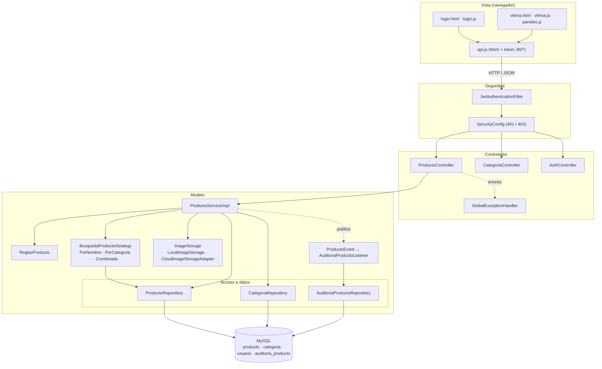
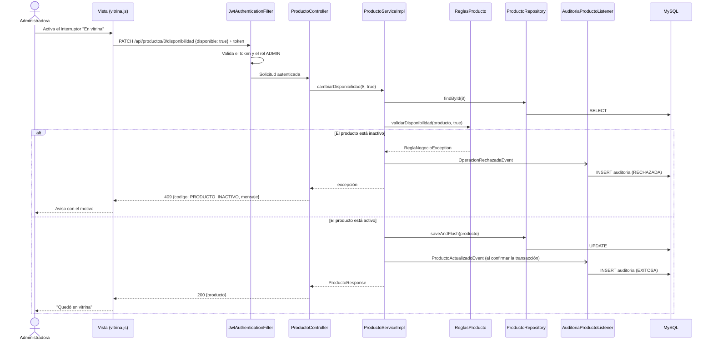
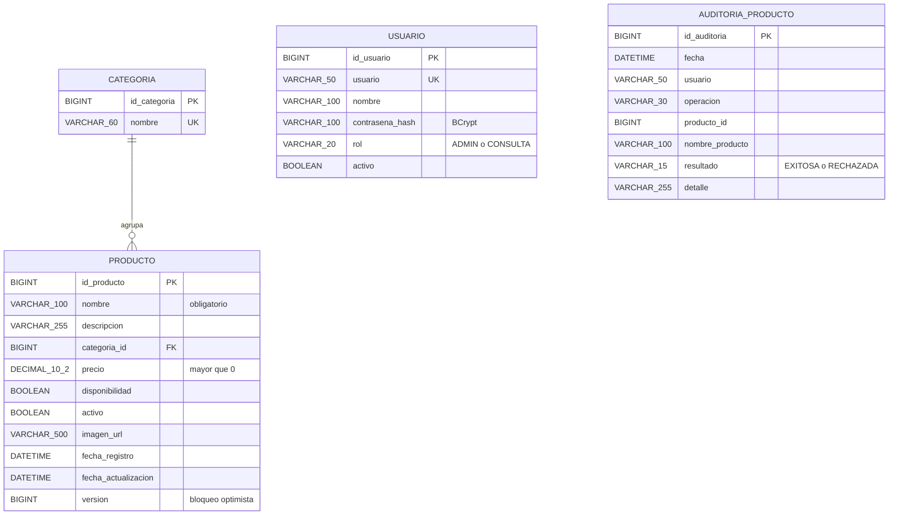

# Documento de arquitectura · Módulo de productos

**Sistema de gestión de pedidos para repostería · Almíbar**
Arquitectura de Sistemas · Universidad Católica Luis Amigó · 2026
Equipo: Mariana Piedrahita Flórez, Sara Melisa Sánchez Vásquez y Sebastián González Campiño
Docente: Javier Darío Cardona Cárdenas

---

## Contenido

1. [Resumen del módulo](#1-resumen-del-módulo)
2. [Análisis del documento de requisitos](#2-análisis-del-documento-de-requisitos)
3. [Requisitos corregidos y propuestos](#3-requisitos-corregidos-y-propuestos)
4. [Stack tecnológico](#4-stack-tecnológico)
5. [Arquitectura MVC](#5-arquitectura-mvc)
6. [Patrones de diseño](#6-patrones-de-diseño)
7. [Regla de negocio](#7-regla-de-negocio)
8. [Principios SOLID y buenas prácticas](#8-principios-solid-y-buenas-prácticas)
9. [Persistencia y modelo de datos](#9-persistencia-y-modelo-de-datos)
10. [Seguridad](#10-seguridad)
11. [Requisitos no funcionales atendidos](#11-requisitos-no-funcionales-atendidos)
12. [API REST](#12-api-rest)
13. [Identidad visual y experiencia de usuario](#13-identidad-visual-y-experiencia-de-usuario)
14. [Pruebas](#14-pruebas)
15. [Limitaciones y trabajo pendiente](#15-limitaciones-y-trabajo-pendiente)

---

## 1. Resumen del módulo

El módulo de productos administra el catálogo de una repostería: registrar, consultar, editar, buscar, listar, desactivar y reactivar productos, controlar su disponibilidad para la venta y asociarles una imagen. Es la base de la que después se alimentará el módulo de pedidos, por eso expone también una consulta pública de los productos que se pueden vender.

Cada producto tiene **dos estados independientes**, tal como lo define el documento:

- **Disponibilidad:** si se puede vender en este momento (por ejemplo, "agotado" cuando se acabaron las unidades).
- **Activo:** si sigue habilitado en el catálogo. Desactivar es una **eliminación lógica**: el producto se conserva con su historial, pero deja de aparecer para nuevos pedidos.

---

## 2. Análisis del documento de requisitos

### 2.1 Lo que define el documento

| Aspecto | Contenido |
|---|---|
| Objetivo | Administrar el catálogo de productos de una repostería y controlar su disponibilidad |
| Atributos del producto | `id_producto`, `nombre`, `descripcion`, `categoria_id`, `precio`, `disponibilidad`, `activo`, `imagen_url`, `fecha_registro`, `fecha_actualizacion` |
| Reglas de negocio | Nombre obligatorio; precio mayor que cero con máximo dos decimales; la categoría debe existir; desactivar no borra ni modifica pedidos anteriores; un producto desactivado no aparece para nuevos pedidos |
| Tecnologías | Java 17, Spring Boot, Spring Web, Spring Data JPA, Hibernate, MySQL, Jakarta Validation, Spring Security, JWT, Lombok, Maven, HTML5, CSS3, JavaScript, Bootstrap 5, Git, GitHub, JMeter o k6 |
| Patrones mencionados | Repository, Strategy, Observer y Adapter |
| Relaciones | Producto N:1 Categoría; Usuario (autenticación y auditoría); Pedido (otro módulo) |
| Restricciones | Arquitectura MVC; lógica fuera de los controladores; operaciones de modificación solo para usuarios autorizados |

### 2.2 Inconsistencias y vacíos encontrados, y cómo se resolvieron

| Hallazgo | Decisión |
|---|---|
| La guía de trabajo pedía "eliminar", pero el documento define **desactivar** (RF-04, RNF-24) | `DELETE /api/productos/{id}` hace eliminación lógica: `activo = false` |
| El ejemplo de regla de negocio de la guía hablaba de existencias, pero el documento **no contempla inventario** | Se implementó la regla propia del documento: un producto inactivo no puede estar disponible (sección 7) |
| No hay requisito para crear categorías ni se definen sus atributos | `Categoria(id, nombre)` con cinco categorías precargadas y un endpoint de solo consulta |
| RNF-07 pide distinguir usuarios con y sin permisos, pero no define roles | Dos roles: `ADMIN` (modifica) y `CONSULTA` (solo lee) |
| La estructura de carpetas incluye `templates/`, pero el stack no incluye Thymeleaf | La vista se construyó con HTML, CSS y JavaScript en `static/`, consumiendo la API REST (lo permite la sección 6 del documento) |
| RNF-01 a 05, 17 y 26 no se pueden comprobar en un equipo local | Se implementó todo lo necesario para medirlos (índices, paginación, scripts de k6, respaldos, monitoreo) y se documenta que su cumplimiento se confirma al ejecutar las pruebas en un servidor |
| Bootstrap 5 tiende a producir interfaces genéricas | Se usa solo su grilla (`bootstrap-grid.min.css`); los componentes visuales son propios |

---

## 3. Requisitos corregidos y propuestos

Estados de la evaluación: **Correcto**, **Precisado** (se le agregó detalle), **Corregido** (tenía una inconsistencia) y **Propuesta** (no estaba en el documento original y se identifica con la letra P).

### 3.1 Requisitos funcionales

| Código | Requisito | Estado | Implementación |
|---|---|---|---|
| RF-01 | El ADMIN registra un producto con nombre, descripción, categoría, precio y disponibilidad. Queda activo; la imagen se sube con RF-10 | Precisado | `POST /api/productos` → `ProductoServiceImpl.registrar` |
| RF-02 | Consultar el detalle de un producto por id (404 si no existe) | Correcto | `GET /api/productos/{id}` |
| RF-03 | El ADMIN edita nombre, descripción, categoría, precio y disponibilidad; el id, el estado y las fechas no se editan | Precisado | `PUT /api/productos/{id}` |
| RF-04 | Desactivar (eliminación lógica): `activo = false` y `disponibilidad = false`; 409 si ya estaba inactivo | Correcto | `DELETE /api/productos/{id}` |
| RF-05 | Buscar por nombre (contiene, sin distinguir mayúsculas), categoría, disponibilidad y estado, combinables y paginados | Precisado | `GET /api/productos?...` + patrón Strategy |
| RF-06 | Listado paginado con nombre, categoría, precio, disponibilidad, estado e imagen (20 por defecto, 100 máximo) | Precisado | `GET /api/productos?page=&size=` |
| RF-07 | Validar antes de guardar: nombre obligatorio (100), descripción (255), precio > 0 con dos decimales, categoría existente | Precisado | Jakarta Validation en `ProductoRequest` + `ReglasProducto` |
| RF-08 | Toda respuesta indica `disponibilidad`, `activo` y `vendible` (se fusionó con RF-02 y RF-11) | Corregido | Campo calculado `Producto.esVendible()` |
| RF-09 | Asociar cada producto a una categoría existente (422 si no existe) | Corregido | Llave foránea + `ProductoServiceImpl.buscarCategoria` |
| RF-10 | El ADMIN sube o reemplaza la imagen; al reemplazarla se borra la anterior | Precisado | `POST /api/productos/{id}/imagen` + patrón Adapter |
| RF-11 | Consultar solo los productos activos y disponibles | Correcto | `GET /api/productos/disponibles` (público) |
| RF-12 | Fechas de registro y actualización automáticas | Correcto | `@PrePersist` y `@PreUpdate` en `Producto` |
| RF-P01 | Consultar categorías | Propuesta | `GET /api/categorias` |
| RF-P02 | Reactivar un producto (vuelve activo, pero no disponible) | Propuesta | `PATCH /api/productos/{id}/reactivar` |
| RF-P03 | Cambiar la disponibilidad rápidamente, aplicando la regla de negocio | Propuesta | `PATCH /api/productos/{id}/disponibilidad` |
| RF-P04 | Iniciar sesión y recibir un token JWT | Propuesta | `POST /api/auth/login` |

### 3.2 Requisitos no funcionales

| Código | Requisito | Estado | Implementación |
|---|---|---|---|
| RNF-01 | p95 ≤ 2 s en listado y detalle con 300 usuarios y 5.000 productos | Preparado para medición | Paginación en el servidor, índices, `carga/consultas.js`, `scripts/semilla-5000-productos.sql` |
| RNF-02 | p95 ≤ 2,5 s en búsquedas con 300 usuarios | Preparado para medición | Índices en nombre, categoría y estado; consultas por estrategia; `carga/busquedas.js` |
| RNF-03 | 300, 500 y 700 usuarios; ≥ 99 % y ≥ 98 % de éxito | Preparado para medición | `carga/escalabilidad.js` con umbrales; pool de conexiones e hilos configurables |
| RNF-04 | Estrés de 700 usuarios por 10 min sin perder integridad | Preparado para medición | `carga/estres.js`, transacciones, bloqueo optimista, `scripts/verificar-integridad.sql` |
| RNF-05 | Disponibilidad mensual del 99,5 % | Preparado | `/actuator/health`, reinicio automático del contenedor de MySQL, procedimiento de recuperación |
| RNF-06 | Escrituras con autenticación; 401 sin token válido | Correcto | `JwtAuthenticationFilter`, `SecurityConfig`, `RespuestasSeguridad` |
| RNF-07 | 403 para usuarios sin permisos | Precisado | Roles ADMIN y CONSULTA en `SecurityConfig` |
| RNF-08 | HTTPS en producción | Correcto | Perfil `prod` (`application-prod.properties`) |
| RNF-09 | BCrypt y secretos fuera del código | Correcto | `BCryptPasswordEncoder`; `.env` y variables de entorno |
| RNF-10 | Id único, nombre obligatorio, precio válido, categoría existente | Correcto | Validación + restricciones PK, FK y CHECK |
| RNF-11 | Transacciones | Correcto | `@Transactional` en el servicio |
| RNF-12 | Registrar un producto en máximo 3 minutos | Correcto | Formulario de tres grupos con ayudas y validación inmediata |
| RNF-13 | Accesibilidad | Correcto | Etiquetas, teclado, foco visible, errores con texto e ícono, `alt`, contraste AA |
| RNF-14 | Chrome, Edge y Firefox | Correcto | HTML, CSS y JS estándar, sin funciones experimentales |
| RNF-15 | MVC | Correcto | Sección 5 |
| RNF-16 | Pruebas con ≥ 70 % de cobertura en la lógica | Precisado | JUnit 5, Mockito, MockMvc, Testcontainers; JaCoCo con regla del 70 % |
| RNF-17 | Respaldo diario, pérdida máxima 24 h, recuperación ≤ 4 h | Preparado | `scripts/respaldo.*` y `scripts/restaurar.*` (miden la duración) |
| RNF-18 | Registro de actividades | Correcto | Observer → tabla `auditoria_producto` |
| RNF-19 | Errores sin datos sensibles | Correcto | `GlobalExceptionHandler`, `server.error.include-stacktrace=never` |
| RNF-20 | Configuración por ambiente | Correcto | Perfiles `dev`, `test`, `prod` + `.env` |
| RNF-21 | JPG, PNG o WEBP de máximo 5 MB | Precisado | `ImagenValidator` y `FormatoImagen` (firma real del archivo) |
| RNF-22 | Imágenes fuera de la base de datos | Correcto | `LocalImageStorage` o Cloudinary; en la BD solo la URL |
| RNF-23 | Paginación de 20 por defecto y 100 máximo | Correcto | `ProductoController` con `@Min` y `@Max` |
| RNF-24 | Integridad referencial | Correcto | FK con `ON DELETE RESTRICT`; sin borrado físico |
| RNF-25 | Portabilidad | Correcto | Configuración externa + Docker Compose |
| RNF-26 | Monitoreo | Correcto | `/actuator/health`, `/actuator/metrics` (ADMIN), registro en `logs/almibar.log` |
| RNF-P01 | Formato de error único | Propuesta | `ErrorResponse` |
| RNF-P02 | Token con vencimiento de 1 hora | Propuesta | `JWT_EXPIRACION_MINUTOS` |
| RNF-P03 | Datos iniciales de prueba | Propuesta | `V2__datos_iniciales.sql` |
| RNF-P04 | Responsive de 360 a 1440 px | Propuesta | CSS propio + grilla de Bootstrap |

---

## 4. Stack tecnológico

| Componente | Tecnología | Justificación |
|---|---|---|
| Frontend | HTML5, CSS3 y JavaScript (módulos ES), servidos por Spring Boot desde `static/` | Lo define el documento. Al servirse desde el mismo backend no se necesita CORS ni un segundo servidor |
| Backend | Spring Boot 3.5 (Web, Validation, Data JPA, Security, Actuator) | Lo define el documento; Actuator se agregó para el monitoreo de RNF-26 |
| Lenguaje | Java 17 | Lo define el documento |
| Framework | Spring MVC | Provee los controladores de la arquitectura MVC |
| Base de datos | MySQL 8.4 (LTS) | La define el documento |
| Persistencia | Spring Data JPA + Hibernate + Flyway | JPA e Hibernate los define el documento. Flyway versiona la estructura (tablas, índices, restricciones y datos iniciales) en lugar de dejar que Hibernate modifique la base de datos |
| Estilos e interfaz | CSS propio + grilla de Bootstrap 5.3 | Bootstrap lo define el documento; se usa solo su grilla para no perder la identidad visual |
| Autenticación y seguridad | Spring Security + JWT (jjwt 0.12) + BCrypt | Lo define el documento |
| Herramientas adicionales | Lombok, Maven (con Maven Wrapper), Git, GitHub, JUnit 5, Mockito, Testcontainers, JaCoCo, k6, Docker Compose | Cada una atiende un requisito concreto: construcción, control de versiones, pruebas (RNF-16), carga (RNF-01 a 04) y portabilidad (RNF-25) |

**Documentación de la API:** Swagger/OpenAPI con springdoc-openapi 2.8. Swagger UI en `http://localhost:8080/swagger-ui.html` y la especificación en `http://localhost:8080/v3/api-docs`, con ejemplos de petición y respuesta para cada endpoint (`config/OpenApiConfig.java`). Ver la sección *Documentación de la API* del `README.md`.

---

## 5. Arquitectura MVC

### 5.1 Justificación

**Por qué MVC.** El módulo es, ante todo, un administrador de información con una interfaz web: formularios, listados y operaciones sobre un catálogo. MVC separa justamente esas tres preocupaciones: los datos y las reglas (Modelo), lo que ve el usuario (Vista) y quién recibe y coordina cada solicitud (Controlador). Además, es la arquitectura que define el documento (RNF-15) y la que Spring MVC soporta de forma nativa.

**Cómo se aplica.**

- **Modelo** (`model/`): entidades JPA, repositorios, servicio con la lógica de negocio, reglas, estrategias de búsqueda, eventos de auditoría y almacenamiento de imágenes. Tal como lo describe la sección 6.1 del documento, el servicio y el repositorio forman parte del Modelo.
- **Vista** (`resources/static/`): páginas HTML, hojas de estilo y módulos JavaScript que se ejecutan en el navegador. Muestran la información y envían las solicitudes, pero no consultan la base de datos ni deciden reglas de negocio.
- **Controlador** (`controller/`): reciben la solicitud HTTP, validan su formato, llaman al servicio y devuelven la respuesta en JSON. No contienen lógica de negocio ni consultas.

**Alternativa descartada: arquitectura hexagonal (puertos y adaptadores).** Se consideró porque aísla aún más el dominio de la infraestructura. Se descartó porque el documento establece MVC, el módulo tiene una sola interfaz de entrada (la web) y la complejidad adicional de puertos y adaptadores para cada dependencia no se justifica en este alcance. Aun así, se tomaron dos ideas de esa arquitectura donde sí aportan: el servicio depende de interfaces (`ImageStorage`, `UsuarioActual`) y no de implementaciones concretas.

**Ventajas obtenidas.**

- La vista se puede rediseñar sin tocar las reglas: la identidad visual cambió varias veces durante el desarrollo sin modificar una sola clase Java.
- Cada capa se prueba por separado: el controlador con el servicio simulado, el servicio con repositorios simulados, y todo junto contra MySQL real.
- Es fácil de entender para el equipo y para quien continúe el proyecto.

**Desventajas y cómo se mitigaron.**

| Desventaja | Mitigación |
|---|---|
| El Modelo tiende a crecer y mezclar responsabilidades | Se dividió en subpaquetes por responsabilidad: `entity`, `repository`, `service`, `rules`, `search`, `event` y `storage` |
| El controlador puede terminar con lógica de negocio ("controlador gordo") | Regla explícita: el controlador solo traduce HTTP ↔ servicio; toda regla está en `ReglasProducto` |
| La vista en el navegador puede duplicar validaciones | La vista valida solo para dar respuesta inmediata; la validación que manda es la del backend |

### 5.2 Diagrama arquitectónico



### 5.3 Recorrido de una solicitud: cambiar la disponibilidad



### 5.4 Estructura de carpetas

```
reposteria-productos/
├── pom.xml, mvnw, mvnw.cmd     Construcción (Maven Wrapper) y regla de cobertura del 70 %
├── docker-compose.yml          MySQL 8.4
├── .env.example                Plantilla de variables de entorno (sin secretos)
├── carga/                      Pruebas de carga con k6 (RNF-01 a 04)
├── scripts/                    Respaldo, restauración, semilla de 5.000 productos y verificación de integridad
├── docs/ARQUITECTURA.md        Este documento
└── src/
    ├── main/java/com/reposteria/productos/
    │   ├── controller/         CONTROLADOR: ProductoController, CategoriaController, AuthController
    │   ├── dto/request/        Datos de entrada con validaciones de formato
    │   ├── dto/response/       Datos de salida y formato de error
    │   ├── mapper/             Entidad → DTO
    │   ├── model/              MODELO
    │   │   ├── entity/         Producto, Categoria, Usuario, Rol, AuditoriaProducto…
    │   │   ├── repository/     Repositorios Spring Data y especificaciones de búsqueda
    │   │   ├── service/        ProductoService, ProductoServiceImpl, CategoriaService, AutenticacionService
    │   │   ├── rules/          ReglasProducto
    │   │   ├── search/         Estrategias de búsqueda
    │   │   ├── event/          Eventos y AuditoriaProductoListener
    │   │   └── storage/        ImageStorage, implementaciones, validador y formatos
    │   ├── security/config/    SecurityConfig y respuestas 401/403 (rutas protegidas)
    │   ├── security/jwt/       JwtService, filtro (middleware), usuario actual
    │   ├── config/             Propiedades, selección de almacenamiento, recursos web
    │   └── exception/          Excepciones propias y GlobalExceptionHandler
    ├── main/resources/
    │   ├── application*.properties   Configuración común y por ambiente
    │   ├── db/migration/             V1 (estructura) y V2 (datos iniciales)
    │   └── static/                   VISTA: login.html, vitrina.html, css/, js/, fonts/, img/
    └── test/java/…                   Pruebas unitarias, de API y de integración
```

---

## 6. Patrones de diseño

Se implementaron los cuatro patrones que menciona el documento. La guía de trabajo sugería entre dos y tres; **el equipo decidió incluir los cuatro** porque cada uno resuelve un problema concreto del módulo. Si se debiera reducir a tres, el primero en retirarse sería Strategy, porque el propio documento lo condiciona a que las búsquedas no sean simples.

### 6.1 Repository

- **Problema:** si el servicio escribiera SQL, la lógica quedaría amarrada a MySQL y no se podría probar sin base de datos.
- **Clases:** `ProductoRepository`, `CategoriaRepository`, `UsuarioRepository`, `AuditoriaProductoRepository` (interfaces que implementa Spring Data JPA), `ProductoSpecifications` y las entidades.
- **Interacción:** `ProductoServiceImpl` solo conoce las interfaces; Spring inyecta la implementación generada. Las consultas traen la categoría en la misma consulta con `@EntityGraph`.
- **SOLID:** DIP y SRP.
- **Beneficio:** el servicio se prueba con repositorios simulados (`ProductoServiceImplTest`).

### 6.2 Strategy

- **Problema:** cuatro filtros combinables generarían una cadena de condiciones en un solo método.
- **Clases:** `BusquedaProductoStrategy` (interfaz), `BusquedaPorNombre`, `BusquedaPorCategoria`, `BusquedaCombinada` y `CriteriosBusqueda`.
- **Interacción:** el servicio recibe todas las estrategias ordenadas con `@Order` y usa la primera cuyo `aplicaA(criterios)` sea verdadero. Las búsquedas simples usan consultas directas sobre los índices; la combinada arma una consulta dinámica.
- **SOLID:** OCP (un criterio nuevo es una clase nueva) e ISP (la interfaz solo tiene lo de buscar).
- **Beneficio:** cada búsqueda se prueba por separado (`BusquedaStrategyTest`).

### 6.3 Observer

- **Problema:** RNF-18 exige auditar cada operación administrativa. Hacerlo dentro del servicio mezclaría responsabilidades.
- **Clases:** `ProductoEvent` (interfaz), `ProductoCreadoEvent`, `ProductoActualizadoEvent`, `ProductoDesactivadoEvent`, `ProductoReactivadoEvent`, `OperacionRechazadaEvent`, `AuditoriaProductoListener` (observador) y `ProductoServiceImpl` (sujeto, publica con `ApplicationEventPublisher`).
- **Interacción:** las operaciones exitosas se registran solo cuando la transacción se confirma (`@TransactionalEventListener(AFTER_COMMIT)`); las rechazadas se registran en una transacción propia (`REQUIRES_NEW`) para que no se pierdan con el rollback.
- **SOLID:** SRP y OCP (otra reacción, como una notificación, es otro listener).
- **Beneficio:** trazabilidad completa sin tocar la lógica del producto (`ProductosIntegracionTest.auditoriaRegistraExitosasYRechazadas`).

### 6.4 Adapter

- **Problema:** RNF-22 permite guardar las imágenes en un servicio externo, que tiene su propia interfaz.
- **Clases:** `ImageStorage` (interfaz objetivo), `LocalImageStorage`, `CloudImageService` (clase adaptada: cliente REST de Cloudinary con `subir(bytes, idPublico)` y `destruir(idPublico)`), `CloudImageStorageAdapter` (adaptador) e `ImagenesConfig` (elige la implementación).
- **Interacción:** el servicio llama a `guardar(imagen)` y recibe una URL, sin saber si quedó en disco o en la nube. El adaptador traduce URL ↔ id público.
- **SOLID:** DIP y LSP (las dos implementaciones pasan la misma prueba de contrato, `ImageStorageContratoTest`).
- **Beneficio:** cambiar de proveedor es una variable de entorno (`IMAGENES_PROVEEDOR=nube`).

### 6.5 Tabla de evidencia

| Patrón | Clases involucradas | Problema que resuelve | Principio SOLID |
|---|---|---|---|
| Repository | `ProductoRepository`, `CategoriaRepository`, `AuditoriaProductoRepository`, `UsuarioRepository`, `ProductoSpecifications` | Separar el acceso a datos de la lógica de negocio | DIP, SRP |
| Strategy | `BusquedaProductoStrategy`, `BusquedaPorNombre`, `BusquedaPorCategoria`, `BusquedaCombinada`, `CriteriosBusqueda` | Búsquedas combinables sin cadenas de condiciones | OCP, ISP |
| Observer | `ProductoEvent` y sus implementaciones, `OperacionRechazadaEvent`, `AuditoriaProductoListener`, `ProductoServiceImpl` | Auditoría sin acoplarla al servicio | SRP, OCP |
| Adapter | `ImageStorage`, `LocalImageStorage`, `CloudImageService`, `CloudImageStorageAdapter`, `ImagenesConfig` | Usar un proveedor externo de imágenes con otra interfaz | DIP, LSP |

---

## 7. Regla de negocio

> **Un producto inactivo ("fuera de carta") no puede estar disponible para la venta.**

Sale directamente del documento (sección 3): disponibilidad y activo son estados distintos, y un producto desactivado no debe ofrecerse en nuevos pedidos. Es no trivial porque relaciona dos atributos y afecta varias operaciones:

| Operación | Comportamiento |
|---|---|
| Desactivar | Pone `activo = false` y además `disponibilidad = false` |
| Reactivar | Vuelve a `activo = true`, pero deja `disponibilidad = false` hasta que el ADMIN la cambie |
| Cambiar disponibilidad a `true` en un producto inactivo | Se rechaza con **409** y código `PRODUCTO_INACTIVO` |
| Editar un producto inactivo marcándolo disponible | Se rechaza con **409** y código `PRODUCTO_INACTIVO` |
| Desactivar un producto ya inactivo / reactivar uno activo | **409** (`PRODUCTO_YA_INACTIVO` / `PRODUCTO_YA_ACTIVO`) |

**Dónde se aplica (defensa en profundidad):**

1. `model/rules/ReglasProducto.validarDisponibilidad`: la regla.
2. `ProductoServiceImpl`: la aplica antes de modificar y registra el rechazo en la auditoría.
3. MySQL: restricción `chk_producto_inactivo_no_disponible CHECK (activo = TRUE OR disponibilidad = FALSE)`, que la protege incluso si alguien modifica la base de datos sin pasar por la aplicación.
4. Vista: el interruptor no se muestra en productos fuera de carta y el formulario avisa antes de enviar. Es solo una ayuda, no la protección.

**Pruebas:** `ReglasProductoTest`, `ProductoServiceImplTest.CambiarDisponibilidad`, `ProductoControllerTest.reglaDeNegocioResponde409` y `ProductosIntegracionTest` (`cicloCompletoDeUnProducto` y `laBaseDeDatosProtegeLaRegla`).

---

## 8. Principios SOLID y buenas prácticas

### 8.1 Principios SOLID

| Principio | Archivo o clase | Implementación | Justificación |
|---|---|---|---|
| SRP | `ProductoController`, `ProductoServiceImpl`, `ProductoRepository`, `ReglasProducto`, `AuditoriaProductoListener` | Cada clase tiene una sola razón para cambiar: HTTP, coordinación, datos, reglas, auditoría | Un cambio en la auditoría no toca el servicio, y uno en la API no toca las reglas |
| OCP | `BusquedaProductoStrategy` y sus implementaciones; `AuditoriaProductoListener` | Un criterio de búsqueda nuevo es otra clase con `@Order`; otra reacción a los eventos es otro listener | Se extiende sin modificar el código existente |
| LSP | `ImageStorage`, `LocalImageStorage`, `CloudImageStorageAdapter`, `ImageStorageContratoTest` | Ambas implementaciones cumplen el mismo contrato y pasan la misma prueba parametrizada | El servicio funciona igual con cualquiera |
| ISP | `BusquedaProductoStrategy`, `ImageStorage`, `UsuarioActual` | Interfaces pequeñas de uno o dos métodos | Ninguna clase depende de métodos que no usa |
| DIP | `ProductoServiceImpl` depende de `ProductoRepository`, `ImageStorage`, `UsuarioActual`; `ProductoController` depende de `ProductoService` | Inyección por constructor de interfaces | Permite simularlas en las pruebas y cambiar implementaciones (local/nube) |

### 8.2 Buenas prácticas

| Práctica | Archivo o clase | Implementación | Justificación |
|---|---|---|---|
| DRY | `ReglasProducto`, `ErrorResponse`, `ProductoMapper`, `api.js`, `ui.js` | Reglas, formato de error, conversión a DTO y llamadas HTTP en un solo lugar | Un cambio se hace una sola vez |
| KISS | `ProductoRepository`, `ImagenesConfig` | Consultas derivadas de Spring Data; selección del almacenamiento con un `if` simple | Sin capas ni librerías que no aporten |
| Encapsulamiento | `Producto` | Sin setters: solo `registrar`, `actualizar`, `desactivar`, `reactivar`, `cambiarDisponibilidad`, `cambiarImagen` | Ningún componente deja el producto en un estado inválido por accidente |
| Alta cohesión y bajo acoplamiento | Paquetes de `model/` | Cada subpaquete agrupa una responsabilidad; se comunican por interfaces | Facilita el mantenimiento (RNF-15) |
| Validación centralizada | `ProductoRequest`, `ReglasProducto`, `ImagenValidator` | Formato con Jakarta Validation; negocio en las reglas; imágenes en su validador | Cada tipo de validación tiene un único lugar |
| Manejo de errores | `GlobalExceptionHandler`, `RespuestasSeguridad` | Excepciones propias → códigos HTTP con un formato único; nunca trazas ni SQL | RNF-19 y RNF-P01 |
| Nombres descriptivos | Todo el proyecto | Nombres en español del dominio: `desactivar`, `vendible`, `ReglasProducto` | El código se lee como el documento de requisitos |
| Seguridad | `SecurityConfig`, `JwtService`, `.env` | BCrypt, JWT con vencimiento, roles, CSP, secretos fuera del código | RNF-06 a 09 |
| Componentes reutilizables (vista) | `ui.js` (`el`, `icono`, `plato`, `avisar`), `paneles.js` | Construcción segura del DOM con `textContent` (evita XSS) y paneles reutilizados | Consistencia visual y menos código |

---

## 9. Persistencia y modelo de datos



- **Atributos:** se respetan exactamente los de la sección 3 del documento. Se agregó solo `version`, para el bloqueo optimista (evita que dos administradores se pisen los cambios bajo carga, RNF-04).
- **Restricciones:** PK, `UNIQUE` en nombres de categoría y usuario, FK `ON DELETE RESTRICT`, `CHECK (precio > 0)`, `CHECK (activo = TRUE OR disponibilidad = FALSE)` y `CHECK` del rol.
- **Índices:** `nombre`, `categoria_id` y `(activo, disponibilidad)` para RNF-01 y RNF-02.
- **Migraciones:** `V1__crear_tablas.sql` (estructura) y `V2__datos_iniciales.sql` (5 categorías, 2 usuarios y 8 productos). Flyway las aplica al arrancar; Hibernate no modifica la estructura (`ddl-auto=none`).
- **Errores de conexión:** si MySQL no responde, la API devuelve **503** con un mensaje claro y el detalle técnico solo va al registro.
- **Auditoría sin llave foránea, a propósito:** el registro de actividades no debe impedir ninguna operación ni perderse si algo cambia.

---

## 10. Seguridad

| Medida | Dónde |
|---|---|
| Autenticación con JWT firmado (HS256), vencimiento de 1 hora y mensaje claro si venció | `JwtService`, `JwtAuthenticationFilter` |
| Autorización por rol en cada ruta: lecturas para usuarios autenticados, escrituras solo ADMIN | `SecurityConfig` |
| 401 y 403 con el formato de error de la API | `RespuestasSeguridad` |
| Contraseñas con BCrypt | `SecurityConfig.codificadorContrasenas`, `V2__datos_iniciales.sql` |
| Secretos fuera del código (`.env` ignorado por Git, variables de entorno) | `application.properties`, `.env.example`, `.gitignore` |
| API sin estado ni cookies (sin sesión de servidor), por lo que no aplica CSRF | `SecurityConfig` |
| Content Security Policy estricta: solo recursos propios (sin scripts ni estilos en línea) | `SecurityConfig` |
| Vista sin `innerHTML` con datos del usuario (evita XSS) | `ui.js` |
| Imágenes validadas por su contenido real y con tamaño máximo | `ImagenValidator`, `FormatoImagen` |
| Borrado de imágenes limitado a su carpeta (evita salir con `../`) | `LocalImageStorage` |
| Errores sin trazas, SQL ni rutas internas | `GlobalExceptionHandler`, `server.error.*` |
| HTTPS en producción | `application-prod.properties` |
| Métricas del servidor solo para ADMIN | `SecurityConfig`, `management.*` |

---

## 11. Requisitos no funcionales atendidos

| Atributo | Requisitos | Cómo se atiende | Cómo se verifica |
|---|---|---|---|
| Rendimiento | RNF-01, 02, 23 | Paginación en el servidor, índices, consultas con `@EntityGraph` | `carga/consultas.js`, `carga/busquedas.js` |
| Escalabilidad | RNF-03, 04 | Pool de conexiones e hilos configurables; aplicación sin estado | `carga/escalabilidad.js`, `carga/estres.js` |
| Disponibilidad | RNF-05, 17, 26 | Salud en `/actuator/health`, reinicio automático de MySQL, respaldos | Respaldo y restauración cronometrados |
| Seguridad | RNF-06 a 09, 19, 21 | Sección 10 | `ProductoControllerTest`, `JwtServiceTest` |
| Confiabilidad e integridad | RNF-10, 11, 24 | Transacciones, bloqueo optimista, restricciones en MySQL | `ProductosIntegracionTest`, `scripts/verificar-integridad.sql` |
| Usabilidad y accesibilidad | RNF-12, 13, 14 | Formulario agrupado, ayudas, validación inmediata, teclado, contraste AA | Prueba con usuario cronometrada y revisión en tres navegadores |
| Mantenibilidad y testabilidad | RNF-15, 16 | MVC, SOLID, pruebas automatizadas | `mvnw verify` (JaCoCo ≥ 70 %) |
| Portabilidad | RNF-20, 25 | Perfiles, `.env`, Docker Compose, Maven Wrapper | Ejecución en otro equipo siguiendo el README |
| Observabilidad | RNF-18, 26 | Auditoría, `logs/almibar.log`, métricas | Tabla `auditoria_producto`, `/actuator/metrics` |

---

## 12. API REST

Las rutas, métodos, permisos y códigos de respuesta están en la tabla del `README.md`. Resumen de los códigos usados:

| Código | Cuándo |
|---|---|
| 200 | Operación exitosa |
| 201 | Producto creado (con cabecera `Location`) |
| 400 | Formato inválido: campos obligatorios, precio con más de dos decimales, JSON mal formado, parámetros fuera de rango |
| 401 | Sin token, token vencido o alterado, o credenciales incorrectas |
| 403 | Usuario autenticado sin permiso (rol CONSULTA intentando modificar) |
| 404 | Producto o categoría inexistente |
| 409 | Regla de negocio o modificación concurrente |
| 413 | Imagen mayor a 5 MB |
| 422 | Datos con formato correcto pero inválidos (categoría inexistente, archivo que no es imagen) |
| 500 | Error inesperado, sin detalles internos |
| 503 | Base de datos no disponible |

---

## 13. Identidad visual y experiencia de usuario

- **Marca:** *Almíbar*. El módulo se llama *Vitrina*: lo que hoy hay para vender.
- **Concepto:** chocolate blanco, pistacho y madera, tomados de la fotografía de los alfajores. El elemento distintivo es el **glaseado que gotea** (en el inicio de sesión y bajo la barra superior), acompañado del **hilo de chocolate** bajo los títulos.
- **Paleta:** roble `#3A2516` (texto), pistacho `#5B6B1F` (acción principal y "En vitrina"), galleta `#F3E2C4` (agotado), piel de pistacho `#7A2E45` (fuera de carta), chocolate blanco `#FFFDF8` y encalado `#F3F2EE` (fondos). Todos los textos cumplen contraste AA.
- **Tipografía:** Corben para la marca y los nombres de los postres; Figtree para la interfaz.
- **Lenguaje de repostería:** "En vitrina", "Agotado", "Fuera de carta", "Sacar de carta", "Volver a la carta".
- **Pantallas:** inicio de sesión (franja de chocolate blanco y foto a pantalla completa), vitrina (pestañas con conteo por estado, búsqueda, fichas de categoría, tabla con foto en "tabla de madera", interruptor de disponibilidad y paginación), panel lateral para crear y editar (tres grupos de campos y carga de foto con vista previa), panel de detalle y diálogo de confirmación.
- **Estados:** carga con filas de esqueleto, vitrina vacía, sin resultados con "Quitar filtros", error con "Reintentar" y avisos que también leen los lectores de pantalla.
- **Responsive:** en celular la tabla se convierte en bloques apilados y el formulario en una sola columna.

---

## 14. Pruebas

| Tipo | Clases | Qué cubren |
|---|---|---|
| Unitarias de negocio | `ReglasProductoTest`, `ProductoServiceImplTest` | Reglas de precio y disponibilidad; registrar, consultar, editar, desactivar, reactivar, cambiar disponibilidad e imagen; 404; publicación de eventos |
| Unitarias de patrones | `BusquedaStrategyTest`, `ImageStorageContratoTest`, `CloudImageStorageAdapterTest`, `LocalImageStorageTest` | Strategy, Adapter y LSP |
| Unitarias de seguridad e imágenes | `JwtServiceTest`, `FormatoImagenTest`, `ImagenValidatorTest` | Tokens válidos, vencidos y alterados; formatos y tamaño |
| API | `ProductoControllerTest` | Códigos 200, 201, 400, 401, 403, 404, 409, 422 y 500; formato de error |
| Integración (MySQL real) | `ProductosIntegracionTest` | Migraciones, BCrypt, ciclo completo, auditoría, restricciones CHECK, búsquedas, imágenes y roles |
| Carga | `carga/*.js` | RNF-01 a 04 |

Cómo ejecutarlas: ver la sección *Pruebas* del `README.md`.

---

## 15. Limitaciones y trabajo pendiente

- Los objetivos de rendimiento, escalabilidad y disponibilidad (RNF-01 a 05) quedan **preparados para medirse**; solo se pueden afirmar como cumplidos después de ejecutar las pruebas de carga en un servidor con características documentadas.
- HTTPS (RNF-08) requiere un certificado real en producción; el perfil `prod` ya lo admite.
- El almacenamiento en Cloudinary requiere una cuenta propia; por defecto se usa el almacenamiento local.
- La gestión completa de categorías (crear, editar) y de usuarios queda fuera del alcance de este módulo.
